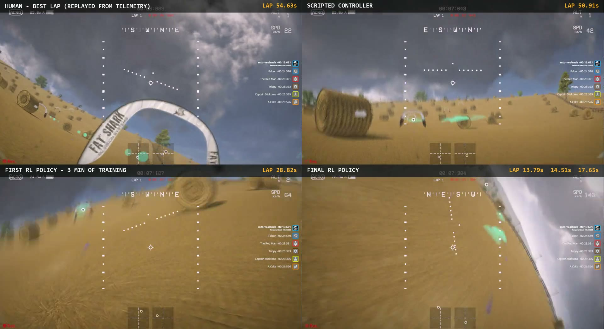
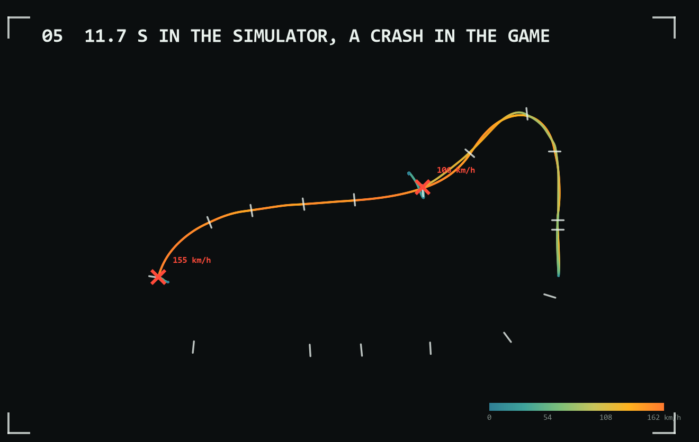
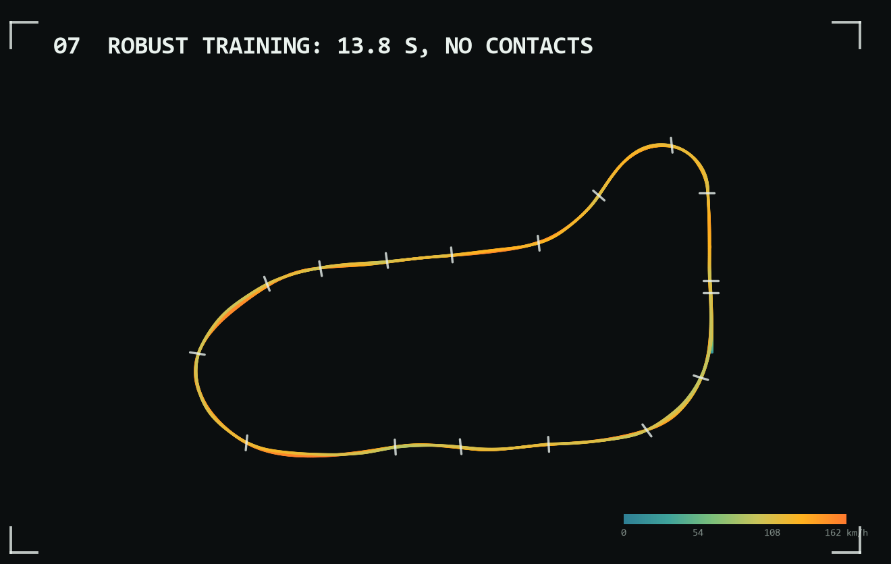
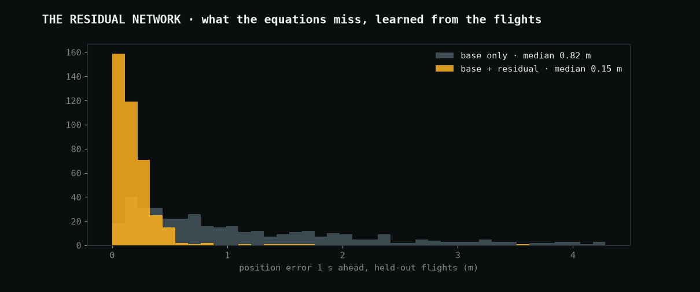
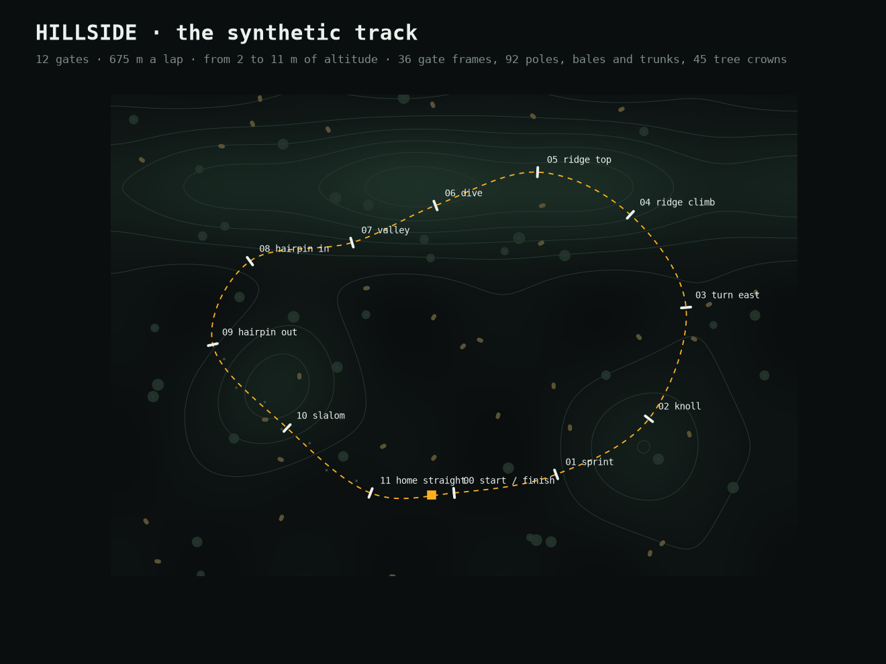
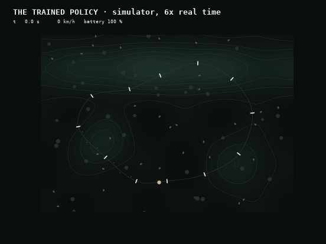
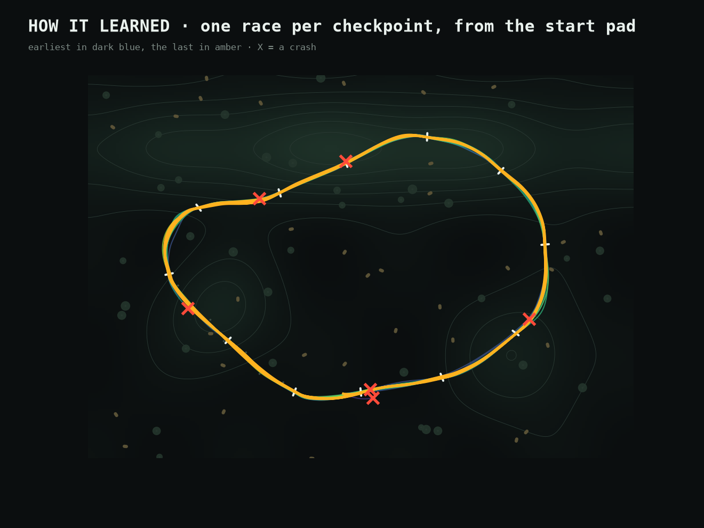
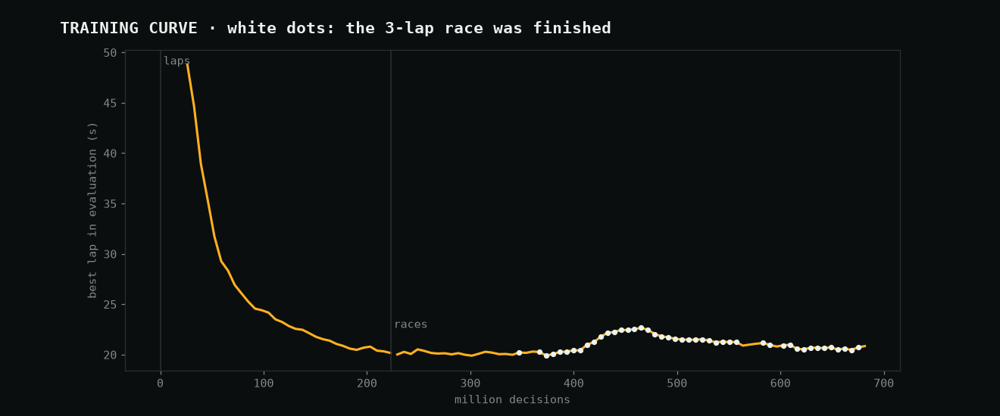
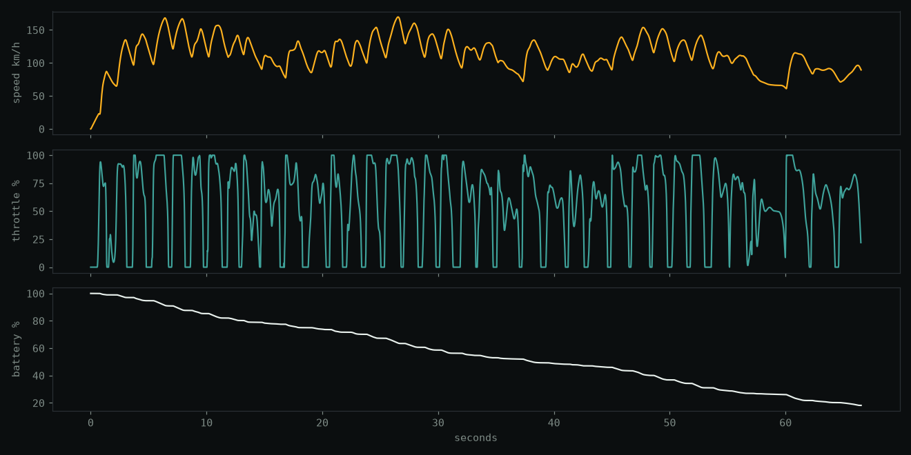

# fpv-racing-rl

**A quadcopter racing simulator in Rust, identified from real flights, and the reinforcement-learning pilot it trained: four times faster than a human on the real track.**

The drone's physics were measured from recorded flights of a commercial FPV racing simulator, rewritten in Rust to run thousands of races at once, and used to train a PPO policy entirely offline. Flown in the real game in real time, with a virtual controller, the policy did three laps of **13.8, 14.5 and 17.6 s** with no contacts. The best human lap on the same track was 55.4 s.

[](media/game-race-grid.mp4)

<sub>The same race in the game, four pilots started together at the finish gate. Top left: the human's best lap (his recorded line and speed, flown again by the controller so it could be filmed). Top right: a classic controller on the measured model. Bottom: the first RL policy, after three minutes of training, and the final one, which does three laps while the human does one. [Video (MP4)](media/game-race-grid.mp4).</sub>

This repository publishes **the simulator engine, the base + residual model with the pipeline that fits it from flight logs, the training code, a synthetic track and a policy trained on it**, so everything here runs end to end. The real track and the model fitted to the real game are not published; nothing from the game itself is.

---

## Results in the real game

| Pilot | Best lap | How |
|---|---|---|
| Human (the author) | 55.4 s | his own controller |
| Scripted controller | 51.1 s | classic cascade controller on the measured model, flying the human line |
| First RL policy | 28.6 s | PPO, **3 minutes** of training in the simulator |
| Final RL policy | **13.8 s** (13.8 / 14.5 / 17.6 in a 3-lap race) | PPO with randomised physics, full races and a safety margin |

The simulator predicted those lap times to within 1–3 % before the policy ever flew them. Positions 1 s ahead are off by 0.17–0.54 m on flights the model was never fitted to, across slow, fast and aggressive flying.

---

## How it got there: seven steps, every one flown in the game

| | |
|---|---|
|  | **The crash that mattered.** Trained for an hour, a policy that lapped in 11.7 s in the simulator crashed in the game at 155 km/h. It had found the place the model had never been checked: above 31 m/s, where the real drag is higher and the battery sags. The fix was not a better pilot but a better model, a safety margin, and training on whole races with the battery running down. |
|  | **Robust: 13.8 s.** Physics randomised per episode (thrust, drag, rates, latency, discharge), and the policy chosen by how it flies when the model is wrong, not by its best simulated lap. |

1. **Telemetry and a virtual controller.** The game streams position, attitude, rates, sticks, battery and motor RPM at 100 Hz over UDP; a virtual gamepad sends the sticks back with 10–17 ms of latency. An automatic test bench (reset, arm, acro mode, take-off) flies identification manoeuvres with no human in the loop.
2. **Physics from data.** A grey-box model (below) fitted to those flights and judged only on whole trajectories it never saw.
3. **The simulator in Rust.** Physics, collisions and gates, bit-for-bit the Python reference, 16 M steps per second per core.
4. **Three minutes of PPO: 28.6 s** in the game, on the first try.
5. **Where the model was wrong:** crashes at 108–155 km/h; drag at speed and battery sag added to the model.
6. **Whole 3-lap races, a safety margin and a small residual network** on top of the physics: 17.8 s.
7. **Robust training: 13.8 s**, three of three laps, no contacts, reproduced on different nights.

**Negative results kept:** correcting rotation with the residual network made trajectories worse; rationing the battery over the race gained under 0.3 s. Both were measured and dropped.

---

## The simulator

### Physics (`sim/src/physics.rs`)

Per body axis, a first-order rate loop on a measured stick-to-rate curve (one step more delay than thrust, as measured). Thrust along the body axis, falling off with the inflow; quadratic drag in the body plane; gravity; semi-implicit Euler at 100 Hz.

```
f_axis  = u² · t0 · g(battery) + k_in · u · v_axis + k_ax · v_axis·|v_axis| + k_ob · u · |v_plane|
f_plane = a · v + b · |v| · v            (forward and side, separate coefficients)
w      += α · (rate(stick) − w)           (per axis, α = 0.66 / 1.0 / 0.80)
battery −= max(0, d2·u² + d3·u³) · dt
```

`v0.2` is the model validated on hover, steps and laps (1 s ahead: 4 cm on manoeuvres); `v0.4` adds the battery and the high-speed drag refit on straights and slaloms up to 46 m/s. The battery sag curve here is a generic LiPo-like one.

### Base + residual model (`sim/src/residual.rs`, `python/residual.py`)

The model that made the policy transfer at racing speed had this shape: a simple physical base fitted by least squares, and a small network that learns what the equations miss. It is published here as code and as a pipeline, fitted on synthetic flights; the numbers fitted to the real game are not.

```
thrust    F   = u² · T(v_axial) · sag(battery) · ground(h)        T: a table over axial speed
aero      A_k = a·v_k + b·v_k|v_k| + c·|V|·v_k + d·F·v_k + e·F     body axes k = lateral, axial, forward
residual  [dF, dA_lat, dA_axial, dA_fwd] = MLP(17 inputs)          17 -> 64 -> 64 -> 4, tanh
```

`fit_base` fits the thrust table and the fifteen aero coefficients by alternating least squares; `train_residual` fits the network on what the base leaves unexplained; `error_ahead` judges the result the only way that matters for a simulator, by how far a whole trajectory drifts after one second, on flights held out from both fits. Give it your own flight logs (position, velocity, attitude, rates, sticks, battery at 100 Hz) and it writes a JSON model; give that JSON to the environment (`cfg={"model": "models/yours.json"}`) and the policy trains on it, with the network's correction and a constant force randomised per episode (`res_min`, `res_max`, `bias_n`).

**The demo** ([`python/residual_demo.py`](python/residual_demo.py)) hides a "true" drone behind 200 synthetic flights: the identified physics plus two things the base cannot express, motors that take about 45 ms to spin up and a side force when yawing at speed. Seeing only the logs, the pipeline cuts the error 1 s ahead on held-out flights from **0.82 m to 0.15 m** (median; p90 2.94 → 0.37 m).



**On real flights** ([`models/telemetry.json`](models/telemetry.json)). The same pipeline, fitted on 70 minutes of our own flights in the real game using **only its official telemetry** (no internal forces, no mass, no game constants; per unit mass, g = 9.81). Four flights were held out from both fits:

| Held-out flight | Base only, 1 s ahead | Base + residual, 1 s ahead |
|---|---|---|
| Aggressive bench manoeuvres | 0.30 m | **0.07 m** |
| Fast straights, up to 46 m/s | 2.43 m | **0.09 m** |
| 3-lap race of the final policy, first night | 0.69 m | **0.53 m** |
| 3-lap race of the final policy, filmed later | 0.76 m | **0.56 m** |

<sub>Medians over every starting point, one each half second. On the fast straights one start in ten still drifts by metres (p90 3.9 m): the network has seen few seconds that fast.</sub>

### World (`sim/src/world.rs`)

Height map (bilinear), oriented boxes, capsules and spheres with exact signed distances, an xz grid for broad phase, gates as oriented rectangles that count only when crossed in their direction, and a flight zone.

### Environment (`sim/src/env.rs`)

N independent races stepped in parallel with rayon, automatic reset, policy at 50 Hz with 1–3 steps of randomised command latency.

- **Observation (59):** body-frame velocity, attitude, body rates, last action, the four corners of the next three gates in body frame, height over the ground, battery, laps left, gate index.
- **Reward:** progress towards the next gate, a bonus per gate and for finishing the race, penalties for crashing, for getting within `d_near` of anything, for body rates and for jerky sticks.
- **Randomisation per episode:** thrust ±5 %, drag ±20 %, rates ±3 %, latency 1–3 steps, discharge ±15 %, start on the pad or anywhere on the line.

### Python API

```python
import fpv_sim
env = fpv_sim.Racing("tracks/hillside.json", n=4096, seed=1, cfg={"race": True, "margin": 0.3})
obs = env.reset()                                  # (4096, 59) float32
obs, reward, terminated, truncated, final_obs = env.step(actions)   # actions (4096, 4) sticks in [-1, 1]
env.episodes()                                     # laps, best lap, race time, how each episode ended
```

### Tests (`tests/`)

| Test | What it checks | Result |
|---|---|---|
| `test_equivalence.py` | Rust physics vs the numpy reference, 3,000 steps of smooth flight and of random stick steps with flips | max position error **5e-13 m**; Rust ~600× faster |
| `test_world.py` | Signed distances, terrain and collision verdicts vs an independent numpy implementation, 6,000+ points | max distance error 3e-14 m; **0** disagreements |
| `test_residual.py` | The base + residual step, network included, Rust vs numpy; a race run on the model | max position error **3e-13 m** |
| `bench.py` | Batched throughput, random actions (worst case: constant crashes and resets) | see below |

| Parallel races | Decisions / s | Physics steps / s | Flight time simulated per second |
|---|---|---|---|
| 256 | 8.8 M | 17.7 M | 49 h |
| 1,024 | 10.3 M | 20.6 M | 57 h |
| 4,096 | 14.0 M | 28.0 M | 78 h |
| 16,384 | 18.1 M | 36.1 M | **100 h** |

<sub>16-core desktop CPU, random actions around hover (constant crashes and resets: the worst case). Training itself runs at ~260,000 decisions per second, limited by the network on the GPU, not by the simulator.</sub>

---

## On the synthetic track

**Hillside** ([`python/make_track.py`](python/make_track.py)) is invented from scratch: 12 gates on a 675 m loop over rolling hills, a climb onto a ridge and a dive off it, gate frames that can be hit, slalom poles, round bales and trees. Everything below was trained and flown on it in **45 minutes on one desktop GPU**.





The published policy ([`policy/hillside.pt`](policy/hillside.pt)) finishes the 3-lap race in **66.5 s**, laps of **20.5, 20.9 and 23.7 s**, the last one slower as the battery sags; top speed 170 km/h, 18 % of the battery left. In evaluation it finishes 32 of 32 races from the start pad with no contacts.

| | |
|---|---|
|  |  |

<sub>Left: one race flown by each saved checkpoint, crashes marked with an X. Right: best evaluation lap over training; white dots where the full 3-lap race was finished.</sub>

**Two lessons from this track, the same as on the real one.**
- **Laps first, races second.** Training straight on 3-lap races from a random policy never got past the first crashes. A first stage of 15 minutes on single laps, then 30 minutes on whole races starting from that policy, did.
- **The first stage learns to skim the ground.** With a 0.3 m safety margin the second stage ended almost every episode in the first second and learned nothing; with 0.1 m it learned to fly higher and safer, slowing down first (the bump in the curve) and then getting faster again while finishing every race.



---

## Run it

```bash
python -m venv .venv && .venv/Scripts/activate          # Python 3.12+
pip install maturin numpy torch matplotlib pillow
cd sim && maturin develop --release && cd ..            # builds fpv_sim (recent stable Rust)
python python/make_track.py                             # tracks/hillside.json (already included)
python tests/test_equivalence.py && python tests/test_world.py && python tests/bench.py

# curriculum: laps first, then whole races from that policy
python train/ppo.py --name laps --minutes 15
python train/ppo.py --name races --minutes 25 --init runs/laps/last.pt --warmup 10 --gamma 0.999 \
    --cfg '{"race": true, "p_start": 0.3, "bat_min": 0.3, "margin": 0.3, "max_steps": 6000}'

python python/render.py race policy/hillside.pt         # fly the published policy and draw it

python python/residual_demo.py                          # fit a base + residual model from synthetic flights
python tests/test_residual.py                           # Rust = numpy for that model
```

On the real track, training from scratch directly on full races did not work either: after an hour the policy still crashed at the same gate. Learning to lap first, then to race, did.

## Layout

```
sim/            Rust crate fpv_sim: physics.rs, residual.rs, world.rs, env.rs, lib.rs (PyO3 bindings)
python/         fpv_sim_ref.py (numpy reference physics), residual.py (base + residual: model, fit, validation),
                residual_demo.py, make_track.py, render.py
train/ppo.py    PPO, one file
tracks/         hillside.json + its height map
policy/         the trained policy for hillside
models/         demo.json (fitted by the synthetic demo) and telemetry.json (fitted on real flights, telemetry only)
tests/          equivalence, residual equivalence, world, throughput
media/          figures and clips
```

MIT licence. Game footage in `media/` was recorded by the author and is shown for illustration; the game and its assets belong to their owners.
